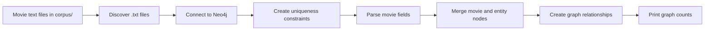
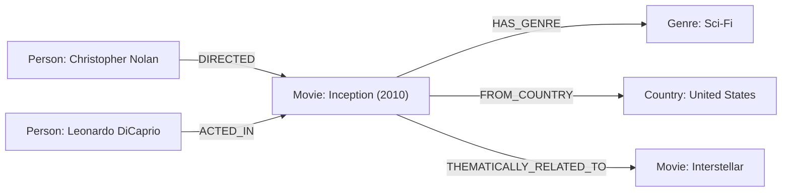

# Movie Graph RAG

A Python ingestion script that loads structured movie records into a Neo4j knowledge graph. The current project covers parsing and graph ingestion; it does not yet include a retrieval or chat interface.

## Workflow



## Requirements

- Python
- A running Neo4j database with Bolt enabled

## Setup

From the project directory, create and activate a virtual environment, then install the Neo4j Python driver:

```powershell
python -m venv .venv
.venv\Scripts\Activate.ps1
python -m pip install neo4j
```

Start your Neo4j database and note its Bolt URI, username, and password. Defaults are `bolt://localhost:7687` and `neo4j` for the URI and username. The script prompts for the password when `NEO4J_PASSWORD` is not set.

You can override the connection settings with environment variables:

| Variable | Default | Description |
| --- | --- | --- |
| `NEO4J_URI` | `bolt://localhost:7687` | Neo4j Bolt connection URI |
| `NEO4J_USER` | `neo4j` | Neo4j username |
| `NEO4J_PASSWORD` | Prompted | Neo4j password |

Run the ingestion:

```powershell
python ingest.py
```

The script reads every `.txt` file in `corpus/`, creates uniqueness constraints, imports the records, and prints node and relationship counts. Re-running it uses Neo4j `MERGE` operations to avoid duplicating nodes and relationships.

## Graph Model

- Nodes: `Movie`, `Person`, `Genre`, `Country`, and `Theme`
- Relationships: `DIRECTED`, `WROTE`, `ACTED_IN`, `HAS_GENRE`, `FROM_COUNTRY`, `HAS_THEME`, and `THEMATICALLY_RELATED_TO`

Movie nodes store their title, year, and plot. The parser expects labeled fields such as `MOVIE ID`, `TITLE`, `YEAR`, `GENRES`, and sections such as `DIRECTOR`, `CAST`, `PLOT`, and `THEMES`; see the existing files in `corpus/` for examples.

## Example Graph

This example shows a subset of the relationships created for the Inception record:



## Data

The `corpus/` directory contains 30 movie records used by the ingestion script. Verify that you have the rights to redistribute these summaries and metadata before publishing or reusing the dataset.

## Credentials

Do not commit passwords or local `.env` files. Set `NEO4J_PASSWORD` in your environment when you do not want to enter it at the prompt; `.env` files are excluded by `.gitignore`.